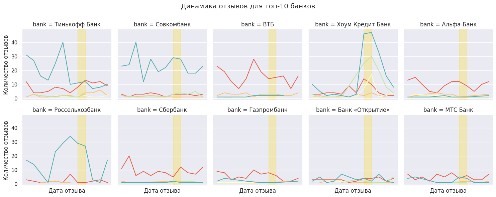
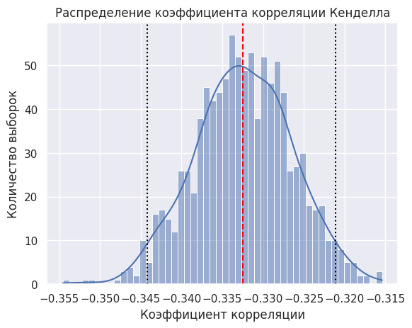
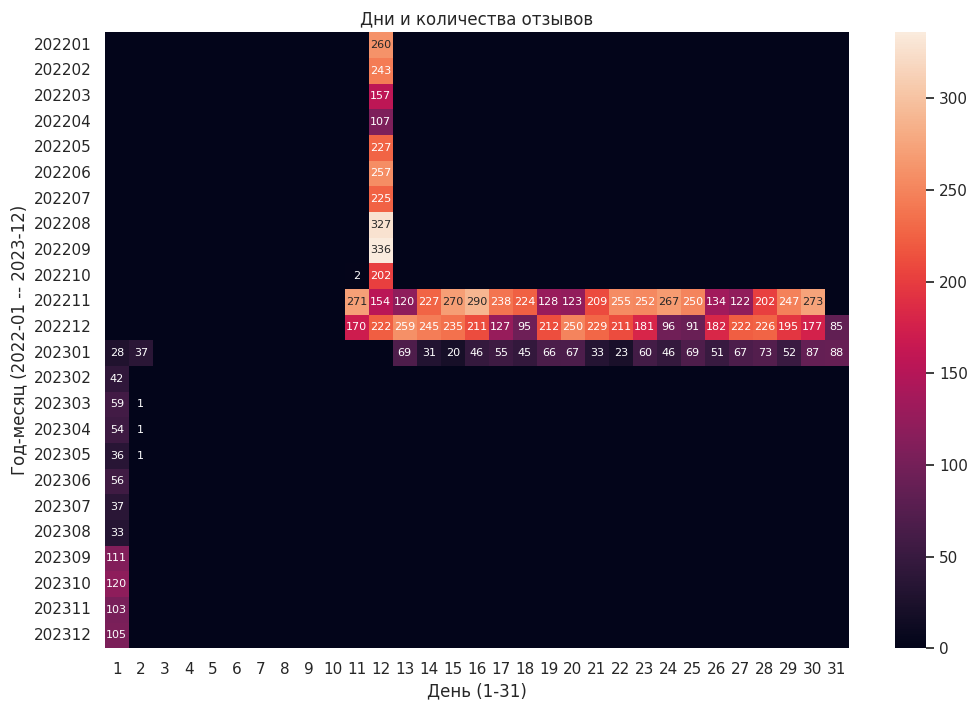

# Разведочный анализ отзывов на банки
Данный репозиторий создан как пет-проект для демонстрации навыка разведочного анализа (EDA) и визуализации данных. Материалом послужил публичный датасет отзывов на банки с сайта banki.ru ([ссылка](https://huggingface.co/datasets/Romjiik/Russian_bank_reviews)).

Выводы, сделанные в результате анализа:
> Датасет включает 12 392 отзыва на 86 банков, собранные в период с 12 января 2022 года по 1 декабря 2023 года. Датасет включает непосредственно текст отзыва, заголовок, никнейм автора на сайте, дату отзыва, название банка, рейтинг, поставленный пользователем банку, количество просмотров и ответов, а также численные оценки по отдельным критериям и длину отзыва -- последние вероятно были добавлены самим автором датасета.
>
>В датасете наблюдается небольшая доля пропусков в заголовке отзыва и никнеймах авторов. Поскольку мы не знаем, как именно был организован сбор данных, мы не можем указать на точную причину пропусков. Однако, у нас получилось выявить их закономерности.
>
>Несмотря на продолжительный период между самой ранней и самой поздней датой отзыва (688 дней), в датасете собраны отзывы, всего лишь за 87 дней, причем в них также наблюдается паттерн.
>
>Банки несбалансированы по количеству оставленных отзывов: оценки всего для десяти из них составляют более 74% всех отзывов. Распределение оценок для всех банков в совокупности отличается полярностью и сравнительной сбалансированностью, тогда как для каждого отдельного банка при сохранении полярности теряется сбалансированность: у одних банков абсолютное большинство оценок крайне отрицательные, у других -- крайне положительные.
>
>95% пользователей оставили всего 1 отзыв, максимальное количество отзывов, оставленное одним пользователем -- 42. Десять наиболее активных пользователей оставили в большинстве своем положительные оценки, которые распределились между Совкомбанком, Тинькофф Банком, Хоум Кредит Банком.
>
>Повышенная активность наблюдалась 12 августа и 12 сентября 2022 года. Тогда в особенности выросло количество оценок для Хоум Кредит Банка -- в большей степени положительных, чем отрицательных.
>
>Мы также рассмотрели две обратные корреляции -- между длиной отзыва и оценкой и оценкой и количеством ответов на отзыв. Обе несут умеренный характер.

Примеры визуализаций:

